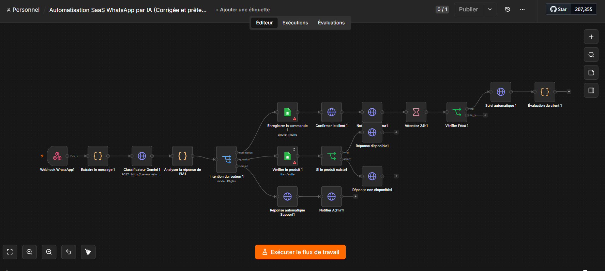
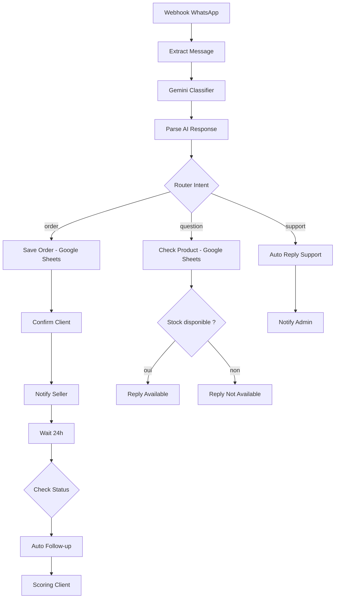

# WhatsApp Order & Support Assistant - Gemini x Green API

Workflow **n8n** qui transforme un numéro WhatsApp en assistant de vente : il comprend le message du client grâce à **Gemini**, enregistre les commandes dans **Google Sheets**, vérifie le stock, prévient le vendeur et relance le client après 24 h.

Pensé pour les petites entreprises qui vendent par WhatsApp et veulent automatiser le suivi sans outil CRM lourd.

## Aperçu



## Fonctionnalités

- Classification automatique de chaque message : `order`, `question` ou `support`
- Extraction du produit, de la quantité et d'un score de confiance
- **Commande** : enregistrement dans Google Sheets, confirmation au client, notification du vendeur, relance après 24 h, scoring du lead
- **Question** : vérification du stock dans Google Sheets, réponse "disponible" ou "rupture"
- **Support** : réponse automatique au client et alerte à l'administrateur
- Aucun secret dans le code : tout passe par des variables d'environnement

## Architecture



## Stack

| Brique | Rôle |
|---|---|
| n8n | Orchestration du workflow |
| Google Gemini | Classification d'intention et extraction produit/quantité |
| Green API | Envoi des messages WhatsApp |
| Google Sheets | Base de données légère (commandes et produits) |

## Démarrage rapide

1. Importer `workflow.json` dans n8n (**Workflows > Import from file**)
2. Créer le Google Sheet (voir `data/`)
3. Définir les variables d'environnement (voir `.env.example`)
4. Connecter les credentials Google Sheets
5. Tester avec la commande `curl` de [docs/testing.md](docs/testing.md)

Guide détaillé : [docs/installation.md](docs/installation.md)

## Documentation

- [Installation et configuration](docs/installation.md)
- [Description de chaque nœud](docs/nodes.md)
- [Tests](docs/testing.md)
- [Limites connues et roadmap](docs/limitations-and-roadmap.md)

## Structure du repo

```
.
├── workflow.json
├── README.md
├── .env.example
├── .gitignore
├── LICENSE
├── data/
│   ├── Products.csv
│   └── Orders.csv
├── docs/
│   ├── installation.md
│   ├── nodes.md
│   ├── testing.md
│   └── limitations-and-roadmap.md
└── images/
    └── workflow.png
```

## Sécurité

- Aucune clé API, aucun token ni numéro de téléphone dans ce repo
- Secrets lus via `$env.*` (n8n)
- Pense à protéger le webhook (voir [limites connues](docs/limitations-and-roadmap.md))

## Auteur

Nombré Alidou Salim

## Licence

MIT
